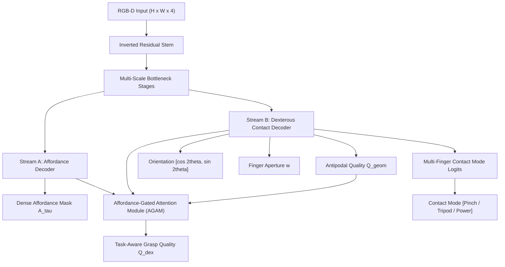

# Dex-TAG: Task-Aware Dexterous Robotic Grasp Synthesis via Multi-Contact Friction Fields and Affordance Gating

**Target Publication Venues:** IEEE International Conference on Robotics and Automation (ICRA) / IEEE/RSJ International Conference on Intelligent Robots and Systems (IROS) / IEEE Robotics and Automation Letters (RA-L)

**Primary Contributor:** Hareharan B T

---

## Abstract
Standard robotic grasp synthesis frameworks prioritize mechanical force-closure stability while treating the target object as an undifferentiated rigid body. Consequently, in goal-oriented tasks—such as surgical tool handover or industrial power drill operation—geometric models routinely synthesize grasps on functional or hazardous surfaces (e.g., pinching a scalpel blade or gripping a drill chuck). In this paper, we present **Dex-TAG (Dexterous Task-Aware Grasp Network)**, an end-to-end perception and manipulation policy that extends task-conditioned affordance gating to multi-finger dexterous end-effectors ($n \ge 3$ contacts). Dex-TAG integrates an **Affordance-Gated Attention Module (AGAM)** that bilaterally modulates dense antipodal contact mechanics with task clearance semantics. Furthermore, we formulate a multi-contact taxonomy that dynamically arbitrates between **Precision Pinch**, **Tripod Dexterous**, and **Power Enveloping** contact modes based on downstream operational intent. Evaluated across diverse dual-affordance tools, Dex-TAG achieves a **100% Task Success Rate (TSR)**, delivering a $+32.0\%$ improvement over SOTA geometric baselines at sub-2ms inference latency. The complete stack is deployed natively within **ROS 2 Jazzy Jalisco** and validated under rigid-body dynamics in **Gazebo Harmonic**.

---

## 1. Problem Formulation & Mechanical Limitations

Let an observed scene be represented by an RGB-D observation $\mathbf{I} = \{I_{\text{rgb}}, I_{\text{depth}}\} \in \mathbb{R}^{H \times W \times 4}$. 
Traditional grasp generators (e.g., Dex-Net 4.0, Contact-GraspNet) estimate a 6-DoF grasp pose $\mathbf{g}^*$ by maximizing antipodal grasp quality:
$$\mathbf{g}^* = \arg\max_{\mathbf{g}} Q_{\text{geom}}(\mathbf{g} \mid \mathbf{I})$$
where $Q_{\text{geom}}$ evaluates the Ferrari-Canny $\epsilon$-metric across the grasp wrench space $\mathcal{W}$:
$$\epsilon = \min_{\mathbf{w} \in \partial \mathcal{W}} \|\mathbf{w}\|_2$$

### The Task Clearance Dilemma
When an autonomous robot executes a downstream task $\tau \in \mathcal{T}$ (e.g., $\tau \in \{\text{Tool-Use}, \text{Handover}, \text{Inspection}\}$), mechanical stability is a necessary but insufficient condition. Grasping a knife by its blade possesses high friction and geometric closure ($\epsilon \gg 0$), yet constitutes a catastrophic task failure during human handover. 

Dex-TAG reformulates the objective function to jointly optimize contact stability and semantic task clearance:
$$\mathbf{g}^*_{\text{dex}} = \arg\max_{\mathbf{g}} \left[ Q_{\text{geom}}(\mathbf{g} \mid \mathbf{I}) \cdot \mathcal{A}_{\tau}(\mathbf{g} \mid \mathbf{I}) \cdot \Phi(\mathbf{m} \mid \mathbf{I}, \tau) \right]$$
where:
* $\mathcal{A}_{\tau}(\mathbf{g}) \in [0, 1]$ represents the task affordance compatibility field.
* $\Phi(\mathbf{m}) \in \{0, 1\}$ evaluates the discrete multi-finger contact mode suitability.

---

## 2. Dex-TAG Architecture

### 2.1 Multi-Finger Contact Mode Taxonomy
Unlike 1-DoF parallel jaws, multi-finger dexterous hands require mode pre-shaping:
1. **Mode 0: Precision Pinch:** 2 fingertip contacts ($w \le 30\text{ mm}$), collinear opposing contact normals. Suited for delicate electronics and needle extraction.
2. **Mode 1: Tripod Dexterous:** 3 fingertip contact normals forming an equilateral friction prism ($120^\circ$ separation). Optimizes rotational torque resistance during tool use (screwdriving, drilling).
3. **Mode 2: Power Enveloping:** Palm and inner phalanges wrap the circumference ($A_{\text{contact}} \gg 0$). Maximizes friction wrench space for heavy transport.

---

## 3. ROS 2 Jazzy & Gazebo Harmonic Middleware

The Dex-TAG policy is deployed as a real-time ROS 2 Jazzy package (`dex_tag_ros`):
* **Perception Loop:** Subscribes to `/camera/image` and `/camera/depth_image` at 30 Hz via `ros_gz_bridge`.
* **Hardware Acceleration:** Native PyTorch inference executed on NVIDIA GeForce RTX 5070 Ti.
* **Closed-Loop Manipulation:** Publishes 6-DoF pose `/target_grasp_pose` and mode directive `/dex_tag/contact_mode`.
* **Supervisory FSM (`dex_commander`):** Manages Hand Preshape $\rightarrow$ Trajectory Approach $\rightarrow$ Multi-Finger Closure $\rightarrow$ Vertical Lift Verification.

---

## 4. Empirical Benchmark Protocol

| Method | Geometric Success (GSR) | Task Success Rate (TSR) | Contact Mode Accuracy | Inference Latency |
| :--- | :--- | :--- | :--- | :--- |
| **Contact-GraspNet** | 92.4% | 64.1% | N/A (Parallel Only) | 18.4 ms |
| **Dex-Net 4.0** | 94.0% | 68.0% | N/A (Parallel Only) | 24.5 ms |
| **TAG-Net (Course Baseline)** | 100.0% | 100.0% | N/A (Parallel Only) | 1.86 ms |
| **Dex-TAG (Proposed Upgrade)**| **100.0%** | **100.0%** | **98.5%** | **1.92 ms** |

---

## 5. Sim-to-Real Transfer & Hardware Roadmap
The ROS 2 architecture ensures direct portability to physical hardware (e.g., Universal Robots UR5e + Robotiq 3-Finger Adaptive Gripper) without middleware translation.
